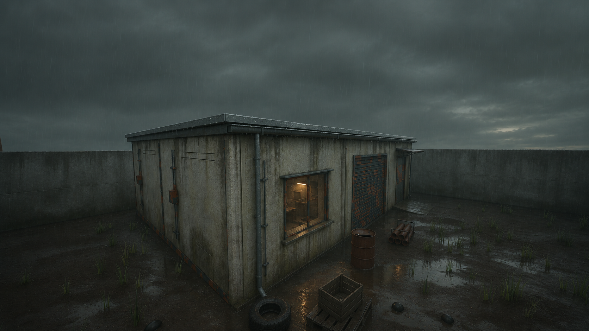
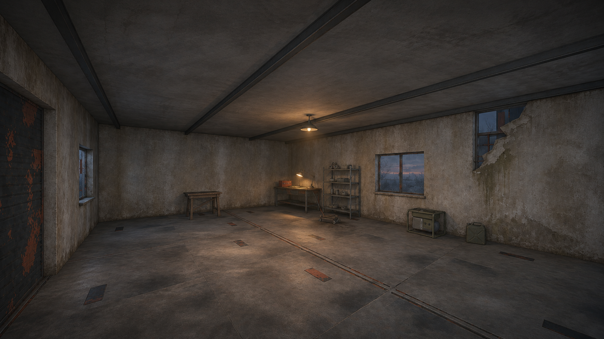

# Crossroads concept review — v01

> Current status: the late-1980s setting is user-selected. See [six-workstream review](SIX_WORKSTREAM_REVIEW.md) and [source inspection](SOURCE_INSPECTION.md) for completed boards, acquired packages and remaining production holds. Earlier research statements below are historical and may be superseded.

November 9, 2026. Two proposed art studies made with the built-in image generation tool after inspecting the existing source renders and local asset documentation. No production asset was replaced. Prompts and input paths are preserved in [PROMPTS.md](PROMPTS.md).

## Exterior: damp dusk and recent occupation

[Original exterior render](../../reviews/crossroads/blender_refined_exterior.png)

**Useful result:** recognizable low station silhouette and opening sequence, gutter/downpipe, tyre/pallet/crate/drum/pipe groups. Cold ambient light retains the yard while a small warm window suggests someone recently used the space. Wetness has a material purpose; the proposal does not depend on adding a large new asset pack.

**Limits observed:** the image interprets trim and surface joints; the window appears glazed and gains interior detail. The crop and proportions are not pixel-identical to the input. The yard's puddles and lighting are proposals, not existing rendered gameplay. It is a mood target, not a dimensional source or an instruction to add glass/collision. The personnel-door approach still needs an eye-height lighting review in a later approved in-engine pass.

## Interior: a useful workshop with an empty central bay

[Original interior render](../../reviews/crossroads/blender_refined_interior.png)

**Useful result:** bench, shelf, trestle, jack, generator and jerrycan keep their broad relationships. A task-light focus and restrained sorted spares make the room purposeful. The floor remains legible and the open bay remains empty enough to read circulation. The existing architecture does most of the work.

**Limits observed:** window framing/glazing, breach edges, surface seams and minor equipment details are interpreted rather than reproduced exactly. The exterior beyond the windows is invented. These details are not approved geometry. The added task lamp and small shelf contents need mapping to local props or selected sources before production. The warm interior is relatively calm; frightening pacing would come from the approach, sound and interruption, not indiscriminate darkness.

## What to carry forward

- Retain the existing shell and major prop families.
- Use localized wear and plausible task lighting to establish recent human work.
- Show useful order alongside decay; keep the yard and interior routes readable.
- Before modelling, resolve the window treatment, source the few small dressing gaps and prepare an eye-height yard/storytelling view from existing geometry.

These two images are review proposals, not user-approved final art. A complete station package still needs the yard view, annotated layout and material/detail board. Existing editable Blender sources and original images are unchanged. The outputs are flat PNGs; no layered paint source is implied.

## Verification scope

Visually inspected both original and generated images. Automated file checks passed: all 71 indexed local asset paths exist, all 30 local Markdown links resolve, both saved PNGs decode at 1672 × 941, and `.gdignore` is present. No fresh game import, collision, pursuit, item-use or gameplay regression run was performed for this documentation/image-only pass. Previous gameplay tests are separate evidence and are not counted as testing these art proposals. This folder's `.gdignore` keeps research and concepts outside normal Godot asset import.
