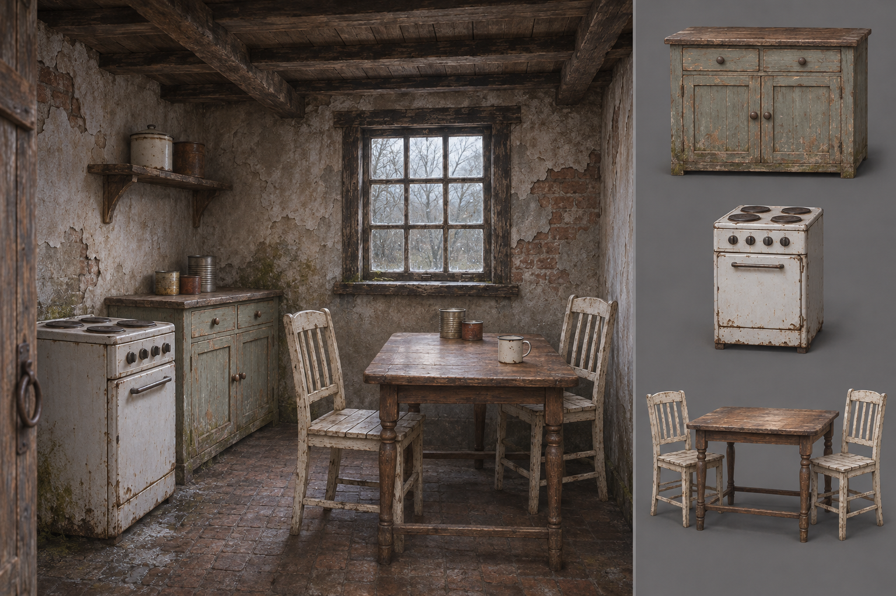

# Cottage kitchen and contents — v01

> Current status: the late-1980s setting is user-selected. See [six-workstream review](SIX_WORKSTREAM_REVIEW.md) and [source inspection](SOURCE_INSPECTION.md) for completed boards, acquired packages and remaining production holds. Earlier research statements below are historical and may be superseded.

November 9, 2026. First cottage interior proposal after domestic sourcing. Generated with the built-in image tool using the existing cottage construction study as a material reference. This is a proposed room, not a render of the actual house interior or downloaded furniture.

## Source map

External candidates below remain listed/researched, not downloaded or imported. Their geometry and materials take precedence over approximate generated depictions if selected for production. Each lists CC0 plus Blender, glTF and FBX formats; package contents still need inspection. Site preview images were not supplied to the generator.

| Visible element | Reuse source | Decision / outstanding check |
| --- | --- | --- |
| Plaster, brick, timber window | [Existing cottage study](../cottage-kit-study.png), current house and shared materials | Keep the established construction language. The image invents the interior arrangement, ceiling and floor; verify against current geometry before production. |
| Painted cupboard | [Painted Wooden Cabinet — Kirill Sannikov](https://polyhaven.com/a/painted_wooden_cabinet) | Preferred candidate; two drawers over double-door storage. Generated proportions/details are approximate. Inspect doors, pivots and footprint. |
| White cooker | [Electric Stove — Kuutti Siitonen](https://polyhaven.com/a/electric_stove) | Preferred candidate; use its actual source design, including oven details, rather than remodelling this drawing. Rig transfer and oven interaction unverified. |
| Small table | [Small Wooden Table 01 — Ulan Cabanilla](https://polyhaven.com/a/small_wooden_table_01) | Newly selected lead: ~3K triangles, 0.9 m wide, 1K–4K textures advertised. Listed as side/end furniture; confirm height and knee clearance before adopting as a dining table. Do not distort its scale to force a fit. |
| Pale chairs | [Painted Wooden Chair 01 — Kuutti Siitonen](https://polyhaven.com/a/painted_wooden_chair_01) | Newly selected lead: 724 triangles, 1 m tall, 1K–8K textures advertised. Inspect seat height and style against table/cupboard. This is a candidate, not a confirmed matching furniture set. |
| Mug and tins | Existing `scenes/props/enamel_mug.tscn` and `scenes/items/held_food_tin.tscn` | Reuse current shapes and material families; generated food containers are illustrative, not replacements for pickup silhouettes. |
| Small shelf and lidded containers | Additional generated dressing | Not source-cleared selections. Omit or map to suitable local/sourced objects later; do not automatically add them to the modelling list. |

The ornate [Wooden Chair 01](https://polyhaven.com/a/WoodenChair_01) was rejected for this room: its Gothic armchair silhouette would shift the ordinary domestic direction. The painted chair candidate fills the same practical need with less visual ceremony.

## Visual review

The composition establishes domestic life through a small meal space, cupboard and cooker. Overcast light makes objects readable; familiar items and absence carry the unease. The right-hand studies make the intended major contents easy to compare with source candidates.

The generated wear is too widespread to become the default for every household. In the next variation, preserve more intact plaster and maintained furniture. Table legs, appliance details and cupboard proportions differ from any exact source model; no geometric fidelity is claimed. The foreground chair and table narrow the apparent path, so a later layout must check passage and chair pull-out space. There is no measured floor plan yet. Plumbing, food-preparation surfaces and power connections remain unresolved; this is a kitchen/meal-space study, not a complete functional kitchen specification.

## Three households from one reusable furniture family

| Household | Keep shared | Change through arrangement | Still needs research |
| --- | --- | --- | --- |
| Long-term residents — this first study | Cupboard, stove, table/chairs, mug/tins | Useful tabletop patch, orderly supplies, some evidence of repair | Food-preparation/wash area, curtains and personal keepsakes |
| Shift worker — next comparison | Same furniture plus existing equipment case/radiator where suitable | One place setting, packed case, less decorative clutter, more intact plaster | Plain bed frame, textile/clothing staging |
| Preparing to leave — later comparison | Same cupboard/table and local crates | Empty storage spaces, belongings grouped for packing, chair pulled into packing position | Appropriate boxes and simple fictional labels |

These variants do not commit three new buildings to the playable map. They test how shared assets can tell different stories. Do not buy or author a separate furniture pack for each household.

## Verification and next step

Visually reviewed the generated board against the existing cottage reference and recorded the discrepancies above. Saved the PNG and exact prompt locally. This art pass does not change gameplay or require a new game import/playthrough.

Next: verify the selected furniture's dimensions from its source before a measured layout, finish missing kitchen utility references, and produce the household comparison. Crossroads yard/layout/material studies remain outstanding alongside this cottage work.
