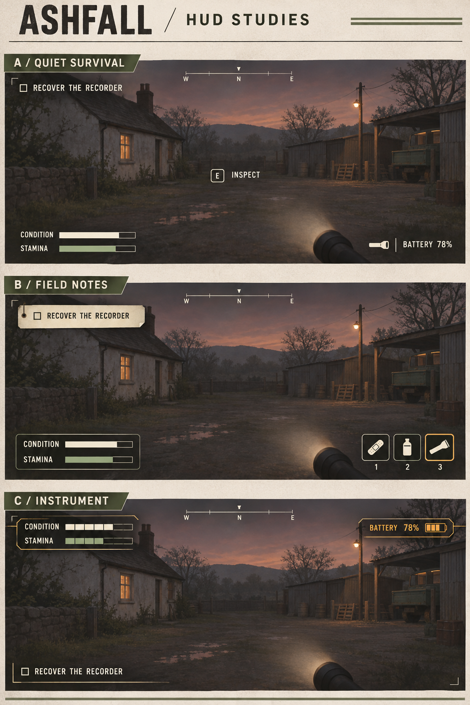

# HUD concepts v01

Generated with the built-in image generation tool. Concept proposals only; the background is illustrative, not a game screenshot. No HUD code changed. Quick slots in B are a proposed interaction, not current implemented controls.

A: Quiet Survival — minimal condition/stamina bars, compass, objective and battery.
B: Field Notes — paper objective tab, grouped status panel and proposed quick items.
C: Instrument — segmented indicators, amber battery panel and lower objective.

## Generation prompt

Use case: ui-mockup. Create one attractive concept comparison board for ASHFALL, a grounded first-person rural survival horror game set in a fictional late-1980s district. Three simple clearly distinct HUD concept sketches, arranged as three large widescreen gameplay mockups stacked vertically on a portrait design sheet. Heading ASHFALL / HUD STUDIES. Each panel shows the same subdued painterly cottage-and-maintenance-yard at dusk, understated flashlight at lower right, ample empty central gameplay space. These are UI design concepts, not actual game screenshots. Clear legible typography and crisp simple HUD shapes over a lightly sketched environment; refined art-director presentation, not elaborate illustration. Palette warm off-white, charcoal, muted utility green, amber warning. Panel A titled A / QUIET SURVIVAL: very minimal overlay, top left single objective “Recover the recorder”, tiny compass at top center, slim labeled CONDITION and STAMINA bars bottom left, flashlight icon and BATTERY 78% bottom right, small central interaction “E  Inspect”. Panel B titled B / FIELD NOTES: functional field-record aesthetic with compact cream paper-tab objective upper left, small orderly dark translucent condition/stamina panel bottom left and three simple quick-item silhouettes bottom right (bandage, bottle, flashlight), understated compass. Panel C titled C / INSTRUMENT: restrained analog field-instrument aesthetic, simple segmented condition and stamina bars, subtle fine rules and amber battery display; compact objective bottom left and compass top center. Keep all gameplay information deliberately sparse, no minimap, no ammo or firearms, no invented hunger thirst or radiation meters, no futuristic holograms, no noisy grunge or unnecessary decoration. Display real differences in arrangement and visual language while keeping readable high contrast and generous screen margins. Short exact labels only, no paragraphs. One cohesive polished presentation sheet.
