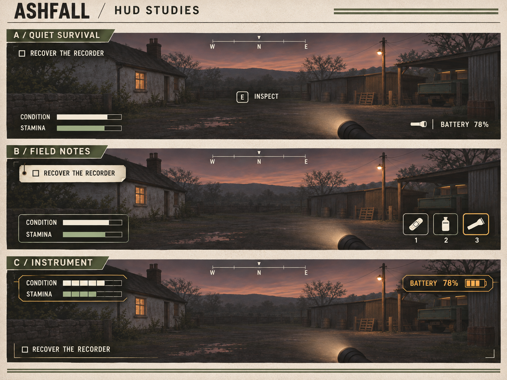

# HUD concepts — 4:3 sheet

Generated with the built-in image tool from hud-concepts-v01.png. Original preserved. No game code changed.

## Edit prompt

Edit the supplied Ashfall HUD concept sheet into a landscape image with an exact 4:3 overall aspect ratio (1536 x 1152 preferred). Preserve the three named concepts A / QUIET SURVIVAL, B / FIELD NOTES and C / INSTRUMENT, their rural dusk background, off-white/utility-green/amber color palette, and their distinct HUD designs and readable text. Recompose the presentation to fit 4:3 naturally rather than squashing, stretching or cropping away content. Use a compact header and three landscape panels stacked with compact margins; keep the HUD labels readable and all three concepts complete. This is a format change, not a redesign; retain ASHFALL / HUD STUDIES heading and concept visual identity. The entire output canvas must be 4 units wide by 3 units high.
