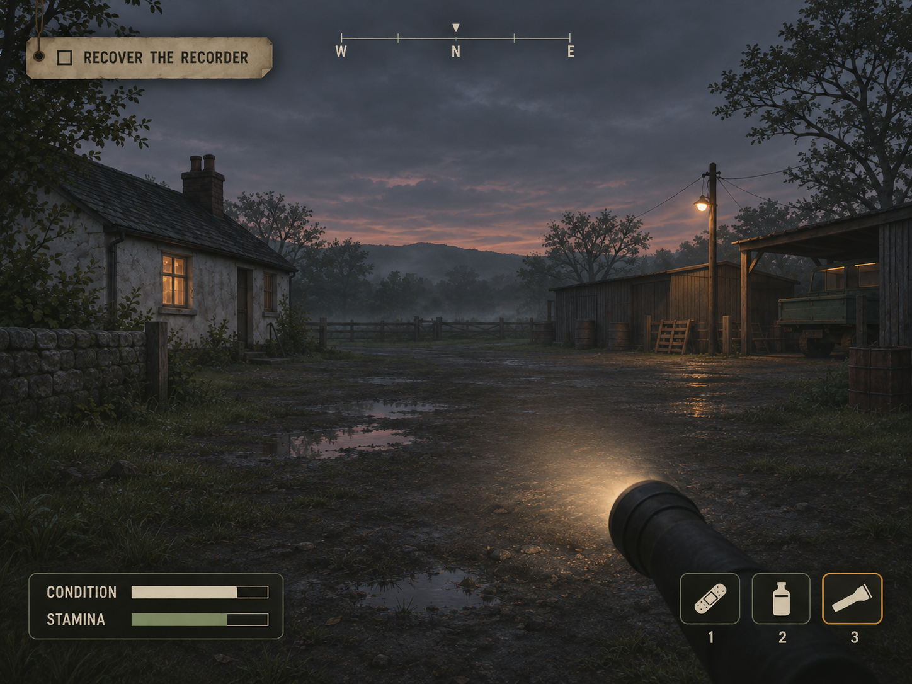

# Ashfall HUD — darker Field Notes direction

The user preferred concept B and requested a slightly darker tone. This standalone 4:3 concept retains the paper objective, compass, grouped condition/stamina and proposed quick items. Dark charcoal panels, muted olive borders and aged taupe paper keep off-white lettering readable.

Generated with the built-in image tool. This is a visual proposal, not a Godot screenshot or implemented UI. Quick-item keys remain proposed controls. Original concepts are retained.

## Prompt

Create a refined standalone version of HUD concept B / FIELD NOTES from the middle panel of the supplied reference. Output landscape 4:3 aspect ratio. Only one full gameplay HUD mockup, no comparison sheet, no large title, no paper framing around the screen. Preserve B's simple practical field-notes identity and placement: small paper objective tag upper left saying RECOVER THE RECORDER, subtle compass centered at the top, compact CONDITION and STAMINA bars in one translucent dark panel bottom left, three quick-item boxes bottom right with bandage, water bottle, flashlight icons and small 1 2 3 labels. Selected flashlight has restrained faded amber outline. Make the UI a little darker and more grounded: objective tag is aged smoky taupe paper rather than bright cream, charcoal translucent status and inventory panels, thin subdued olive-grey borders, slightly weathered off-white text and muted olive stamina, no heavy grunge. Keep text and icons clearly readable. Background retains the reference rural cottage/maintenance yard and flashlight but at a cooler overcast dusk, restrained amber lamps, subtle mist, natural desaturated greens and damp ground. Keep scene visible and navigable rather than black. Broad empty central view, no extra gauges, weapons, minimap or large labels. Polished simple survival horror HUD design concept, illustrative environment not an actual game screenshot. Keep all HUD safely inset from screen edges. Change tone subtly; do not redesign B into futuristic instrument panels.
