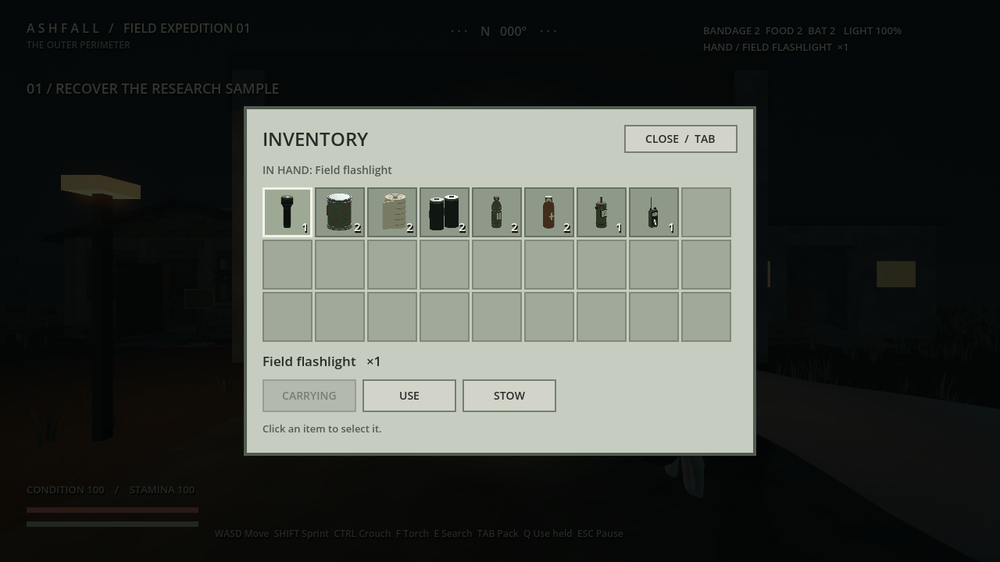

# Items, weapons, characters and horror references

> Current status: the late-1980s setting is user-selected. See [six-workstream review](SIX_WORKSTREAM_REVIEW.md) and [source inspection](SOURCE_INSPECTION.md) for completed boards, acquired packages and remaining production holds. Earlier research statements below are historical and may be superseded.

November 9, 2026. Art scope only. Existing item IDs, effects, hand poses and inventory remain unchanged. External source decisions are in [SOURCE_SHORTLIST.md](SOURCE_SHORTLIST.md).

## Eight items: preserve the readable family

The existing inventory review below supplies a useful baseline. It is a saved review capture, not a fresh playtest. `item_catalog.gd` remains the authority for behavior.

| Existing ID | Keep / recognition cue | Art work to investigate | Source route |
| --- | --- | --- | --- |
| flashlight | Narrow handled tool with broad lamp head | Edge wear at grip and switch; lens definition at close range | Existing handheld asset and grip. No replacement model needed. |
| food_tin | Short cylindrical tin, metal lid, muted label | Label hierarchy visible in hand; distinct from batteries at icon size | Existing tin. Original fictional packaging only after world language/era decision. |
| bandage | Pale wrapped roll with visible circular top | Cloth layers and restrained paper sleeve | Existing roll. Preserve its light silhouette; do not make it look like another can. |
| batteries | Paired dark cells | Polarity/cap readability, wrapper condition | Existing pair. Avoid real battery branding. |
| water_bottle | Narrow neck and ribbed body | Cap and liquid/container distinction at small scale | Existing field bottle and hand fit. |
| antiseptic | Amber medicine bottle | Clear cap silhouette and simple label hierarchy distinct from water | Existing bottle. This is fictional game dressing, not a real medical product label. |
| detector | Broad meter body and visible instrument face | Face readability and response-state art while preserving current proportions | Existing anomaly meter. External multimeter is a bench prop, not its substitute. |
| field_radio | Slim receiver with antenna | Distinguish control groups from detector; preserve antenna silhouette | Existing receiver. Large vintage transceiver is not a handheld replacement. |

**Art acceptance:** review each at its actual inventory tile size, in hand, and against a dark outdoor background. Check both colour and silhouette. Retain simple counts and the existing use/stow behavior. Dense illustrations and elaborate frames should not shrink the item image. Do not alter grip dimensions to chase an attractive concept drawing.

Next item deliverable: a comparison sheet made from the current eight close-up review images, followed by focused material/label studies for genuine weaknesses. The existing item models cover the whole current roster; a generic survival pack would mostly duplicate them.

## Weapons: two sourced appearance candidates, no roster expansion yet

The verified [Service Pistol](https://polyhaven.com/a/service_pistol) and [Bolt Action Rifle 7.62](https://polyhaven.com/a/bolt_action_rifle_7_62) are the initial reuse candidates. Compare their material language, condition, proportions and carrying appearance with the scavenger clothing before choosing. These are visual source options, not a promise that combat is ready or that both weapons should be available to the player.

Later inspection must establish separate moving components, rig/animation availability, grip fit, first-person detail, markings and texture cost. Do not commission a new firearm solely to get a different scratch pattern. A shotgun or improvised melee family needs a gameplay/art role before it adds research and production work.

## Human foundations and clothing

Keep `assets/characters/scavenger/source/ashfall_scavenger.blend`, the authored wardrobe and existing hand work. Local [credits](../../assets/characters/scavenger/CREDITS.md) record the MakeHuman graphical sources. Do not replace a fitted character with a generic zombie pack.

Working clothing families: repaired practical outerwear for residents, utility workwear at Crossroads/relay, and protective outer layers at sample handling. These are proposals, not a complete wardrobe. Investigate reuse of existing garment construction before new meshes; PPE-specific references remain open.

## Creature concept brief: readable behavior before elaborate anatomy

No creature image is approved or generated in this pass. The art question is a formerly familiar human outline whose attention becomes disturbing. Start from the existing body scale and clothing foundation; research original movement before adding anatomical complexity. Do not model the threat on a real disability or rely on a copied game monster.

Proposed first board has four views of **one** candidate: resting, noticing, pursuing and searching. Keep the same proportions across views. A head/upper-body turn can announce attention; a shift of weight can precede a run; deliberate pauses and reorientation can communicate searching. These are proposed animation cues, not descriptions of completed implementation.

Use the [CMU locomotion and environment-interaction library](https://mocap.cs.cmu.edu/) as a potential human motion baseline, with its stated commercial-use restrictions recorded in the shortlist. Choose actual clips before calling any animation sourced. Human capture does not supply fingers, creature identity, sound or a Godot-ready state machine.

Pair each later silhouette with sound-intent notes: idle movement, attention, sustained pursuit, searching and withdrawal should remain distinguishable without relying entirely on music. Search existing project audio before commissioning sounds; a dedicated audio source/license audit is still pending. Visual/audio feedback must support the current fair-detection goals, not imply sight through walls or remove opportunities to escape.

## Anomalies: preserve the existing hazard, refine its evidence

Start from the existing [wetland anomaly concept](../wetland-anomaly.png), current hazard behavior and the anomaly meter. Develop a consistent visual sequence: environmental trace visible before entry, active region, then aftermath. Each cue must be readable at player height and in poor light without turning the whole environment into a glowing fantasy landscape.

Proposed studies: displacement of ordinary grass/debris; localized surface discoloration; a brief, restrained distortion at the hazard boundary. These are artistic proposals, not scientific claims or new damage mechanics. Reuse local reeds, ground and materials for context. Investigate existing effects assets and project audio before authoring a replacement effect. The particular physical reference and effect source are still open, so a final anomaly redesign has not been generated.
