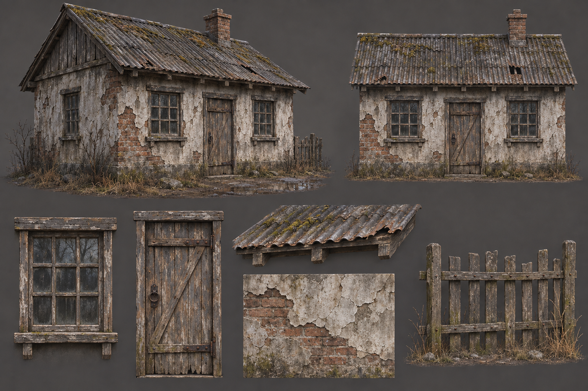
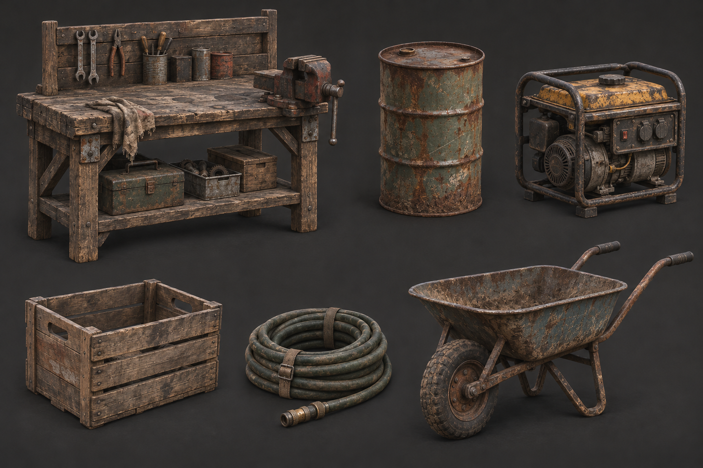
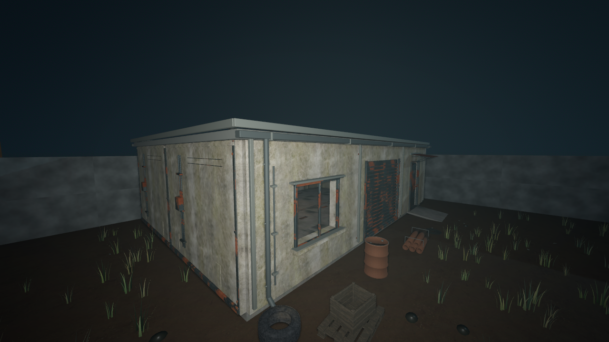

# Ashfall art preproduction — current review

Updated November 9, 2026. **Fictional temperate rural district, late 1980s**, as chosen by the user. Further production 3D/gameplay work is paused for art review.

Start with [the visual index](REVIEW.html), [six-workstream review](SIX_WORKSTREAM_REVIEW.md), [source inspection](SOURCE_INSPECTION.md), [verification](VERIFICATION.md) and [production checkpoint](../../PRODUCTION_CHECKPOINT.md).

Ten generated concept boards cover cottages, Crossroads, checkpoint, research, relay, creature and anomaly direction. Three actual source renders support the weapon/furniture comparisons. All eight current item review captures remain available in the index. [Saved prompts](PACKAGE_PROMPTS.md) document new generation; earlier prompts remain in [PROMPTS.md](PROMPTS.md) and [COTTAGE_PROMPT.md](COTTAGE_PROMPT.md).

Thirteen Blender packages and a sink GLB are now acquired in excluded research staging; this supersedes earlier listed-only status. No purchases or production-scene/gameplay changes. First-review deliverables exist for all six workstreams, with explicit source/fit/animation and art-approval limits. This is not a claim that all production work is complete.

Older briefs and shortlists retain their research history; use the current review and inspection report for present status.

## What we already have

| Local material | Audit result | Decision |
| --- | --- | --- |
| Six images in `concept-art/` | Checkpoint, village, wetland anomaly, checkpoint study, cottage kit, workshop props | Use these as the starting visual references. Avoid generating replacements for the same questions. |
| Crossroads refined source | `assets/crossroads_refined/source/crossroads_station_refined.blend` plus original kit and props Blender files | Keep its low industrial silhouette, practical openings, guttering and repair-yard purpose. Concept changes as additions or adaptations. |
| General props | 32 saved scenes | Reuse storage, utility, checkpoint and basic interior families. |
| Workshop | Eight scenes | Reuse workbench/vise, tyre, wheelbarrow, ladder, extinguisher, crate, hose and chair. |
| Nature | Ten scenes | Keep as the local baseline; assess imported alternatives only where quality or variety materially improves a view. |
| Extra dressing | Seven scenes | Reuse grass, stones, firewood, mushrooms, scrap, shovel and sawhorse. |
| Inventory | Eight catalogued usable item types and eight scenes in `scenes/items/` | Retain identities, scale and existing grip work; investigate appearance changes separately. |
| Characters | Scavenger, mannequins, wardrobe source files and authored hands | Preserve fitted rig and clothing work. Creature silhouette is still a separate concept problem. |
| Materials | Five sourced sets in `assets/materials/sources.json`, plus separate forest-ground credits | Reuse documented plaster, masonry, concrete, timber and corrugated metal. |

Counts are directory/file checks, not totals for every asset in the entire project. Scene variants and embedded geometry are not counted as independent art assets. Some older documentation describes earlier project states; the local files take precedence.

## Existing visual anchors

These are existing project images, not new concepts made during this pass.

### Cottage construction and weathering

### Workshop prop family

### Crossroads as currently authored

## Initial decision

Build Ashfall's art packages around the existing station, cottage, inventory and authored materials. Fill missing domestic and office furnishings from a small coherent source library. Investigate a reusable firearm model before commissioning or generating a whole weapon family. Keep new creation focused on Ashfall-specific creatures, anomaly appearances, narrative objects and location compositions after their reference research.

The setting is now user-selected: fictional district, late 1980s. Creature design and final weapon roster remain review proposals.
