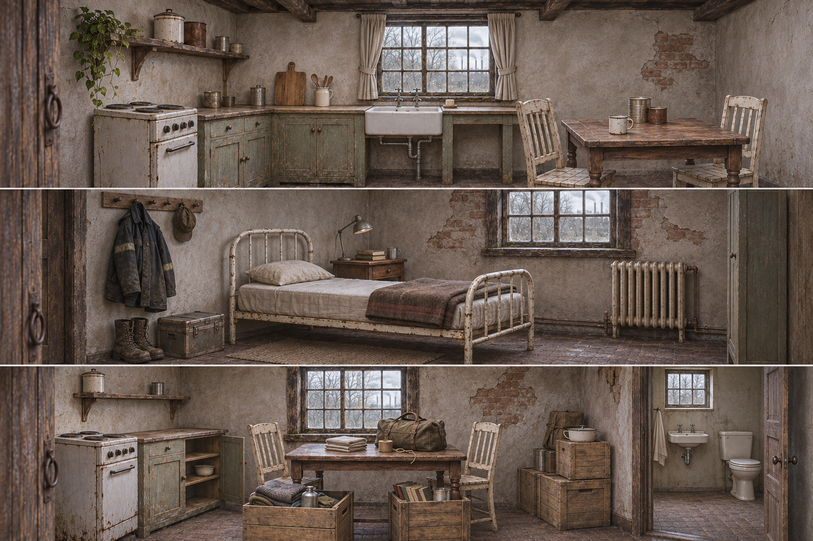
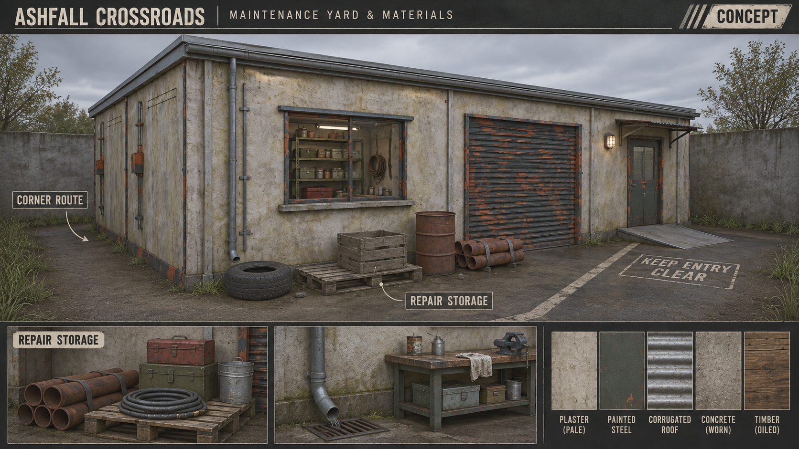
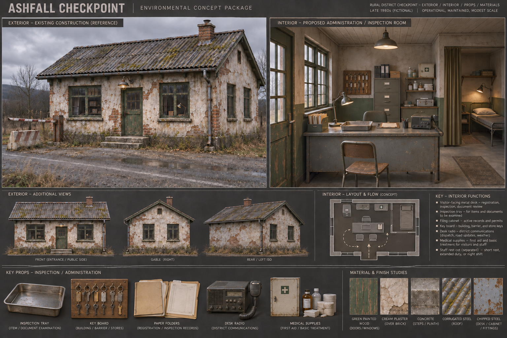
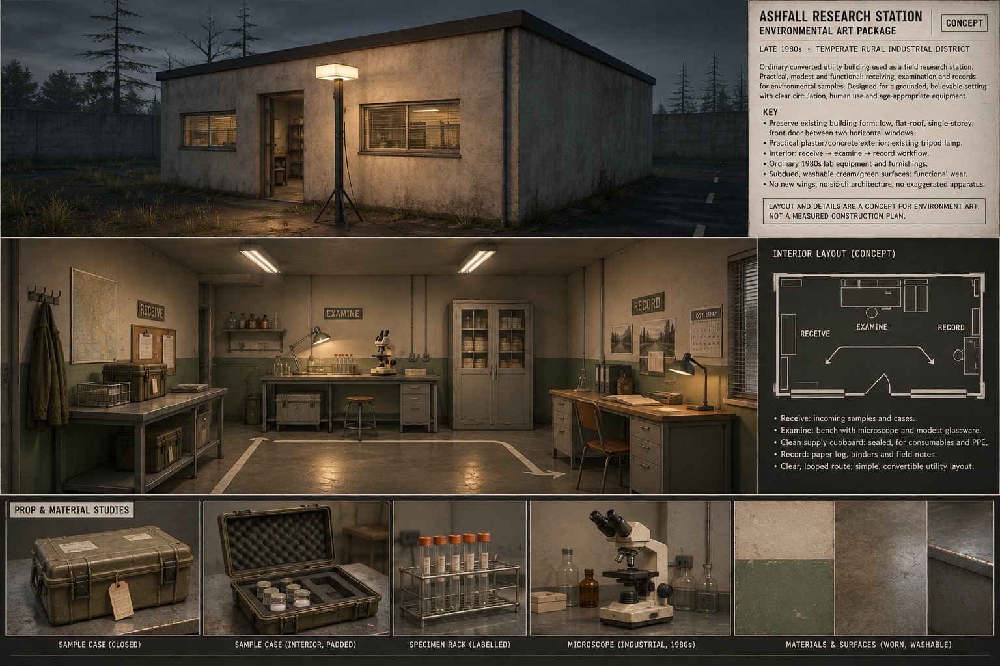
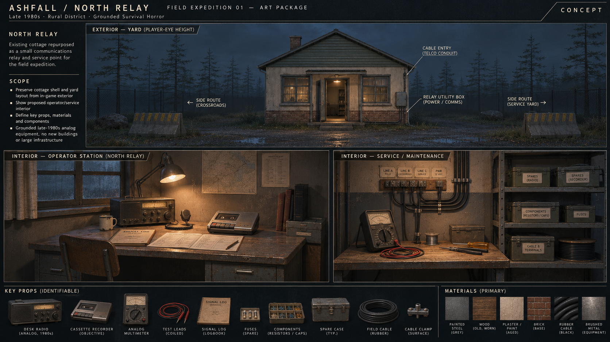
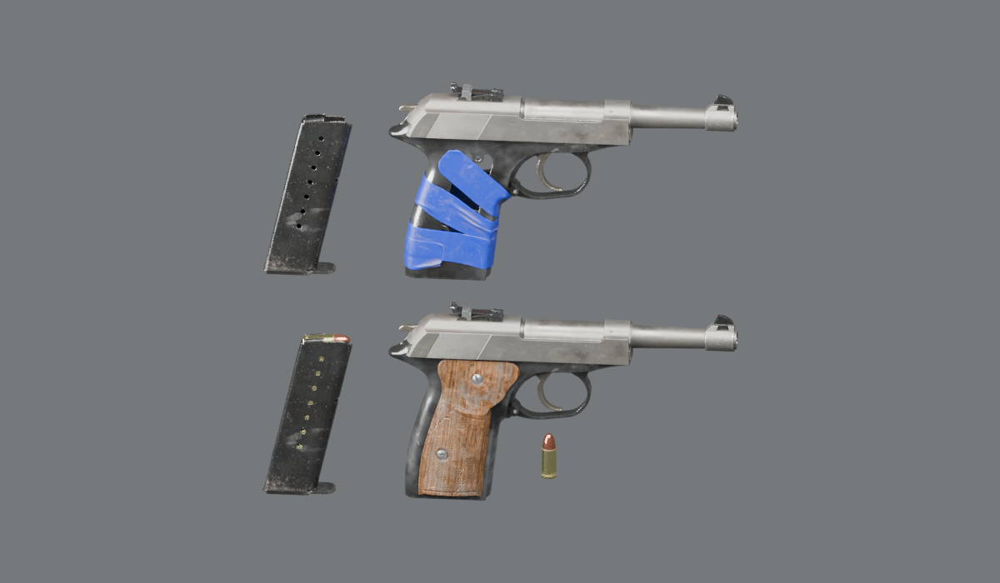
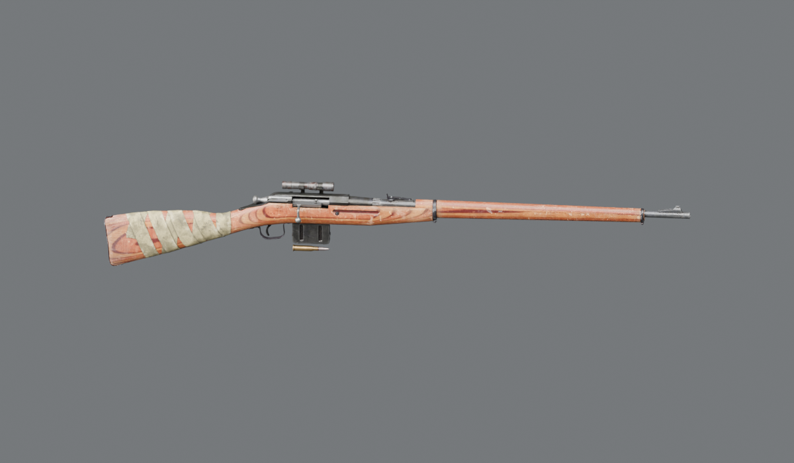
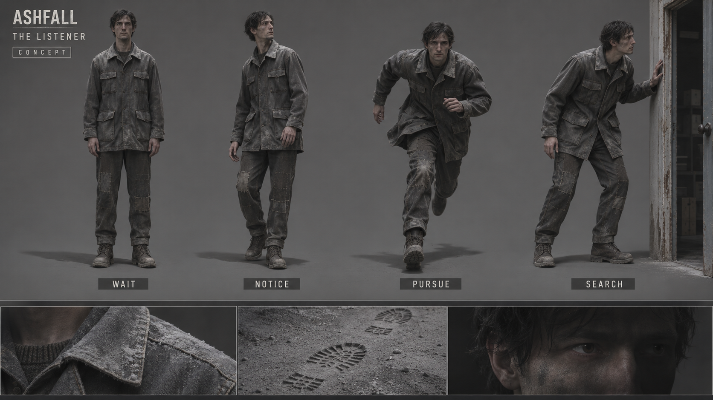
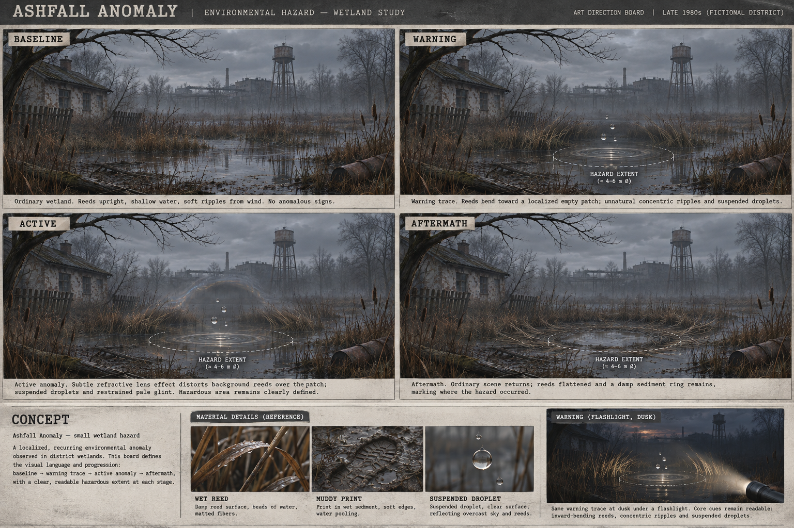

# Ashfall — six-workstream preproduction review

November 9, 2026. **User-selected setting: fictional temperate rural district, late 1980s.** This supersedes earlier open-era notes. All six workstreams have review deliverables. They are proposals, not production-ready assets or user-approved final art. The limitations below remain part of the handoff.

## 1. Cottage family

Maintained household, shift-worker bedroom and packing household share construction/furniture. Added preparation/wash area, bedroom, textiles, belongings and washroom appearance. Keep more intact plaster in inhabited rooms. These variants do not commit three new buildings to the map.

Reuse acquired cupboard, chair, stove, bed, dining table and sink; local radiator, mattress, mug, tins, cases and crates. Curtains/blankets adapt existing fabric materials later. Bathroom basin/toilet remain original-art production briefs: researched free options were flat/stylized and rejected for quality mismatch. The conventional shapes shown are proposals, not acquired or cleared external assets. Do not substitute placeholders to mark this complete.

Source inspection corrected two assumptions: small wooden table is only 0.533 m tall (side table only); cupboard is 1.182 m tall (pantry storage, not kitchen worktop). Replacement dining-table mesh is about 2.047 × 1.152 × 0.791 m, so use it in the larger household, not every tiny kitchen. Stove body is about 0.50 × 0.61 × 0.859 m; package bounds include separate parts. Bed frame is about 0.905 × 2.002 m, height 1.201 m. Preparation counter is a separate adaptation brief. Generated furniture dimensions are not authoritative.

Concept planning envelope for a proposed 7 × 6 m cottage: kitchen/living roughly 3.6 × 3.6 m, bedroom roughly 3 × 3.6 m, rear utility/wash zone. Reserve about 1 m primary passage plus chair pull-out space. This is not verification of any particular existing cottage floor plan. Smaller households should use an appropriately sourced smaller dining solution or a bench/side-table composition rather than scaling the large table unrealistically.

## 2. Crossroads

Together with [dusk](crossroads-dusk-v01.png) and [interior](crossroads-interior-v01.png), this supplies yard, lighting and material direction. Preserve the 12 × 8 m shell, ramp, openings and useful existing prop library. Keep repair storage near the shutter and the personnel-door/west-corner routes legible. Drain grate, exterior lamp and ground lettering are generated proposals. Existing geometry wins over altered trim/window details.

Saved dressing coordinates, local X/Z: shelf (-2.2,-3.58), toolbox (-4.25,-2.94), generator (1.2,-3.1), fuel (2.2,-3.3), extinguisher (5.48,1.8); yard pallet/crate (-4.7,5.5), drum (-2.8,5.1), pipes (-0.1,5.4), hose (1.5,5.55), tyre (-5.55,4.75). Cover markers (-4.8,-2.7), (-6.8,-2.7) indicate solid-wall routes, not automatic invisibility. [Annotated layout](crossroads-layout.svg) records these points; it is not a collision test. Keep the centre bay open.

Retain plaster, corrugated roof, concrete, painted steel and timber. Put dirt at runoff, ground contact, repair surfaces and handled edges. No replacement building pack needed.

## 3. Other buildings

Checkpoint uses inspection/records/rest; research uses receiving/examination/records; relay uses operator/service/spares. Each board includes exterior, interior and distinctive contents/material studies. Shared desks/cases/shelves are intentional reuse.

Checkpoint keeps local cot, medical items, filing cabinet, barrier/radio and acquired office desk. Tray, key board and paper records are small adaptation briefs. Research uses acquired glassware/microscope and local cases/shelves; padded inserts, labels and protective coat are adaptations. Relay uses acquired cassette player/multimeter and local radio, cases, cable spool and electrical cabinet; termination board adapts that electrical family.

Interior partitions/layouts are proposals, not measured current geometry. Generated instruments/cases are approximate. **Keep the North Relay objective at its current rear workbench:** the operator-desk board is appearance direction, not permission to move it indoors. The board's Crossroads route label is illustrative, not a verified link direction. No new tower, bunker or wing is required.

## 4. Inventory and weapons

All eight historical item review images were visually inspected; they are not a new gameplay run. Reuse current assets/grips and the simple grid. The older inspection-screen layout in those images is not a UI redesign proposal.

| Item | Later art refinement, retaining silhouette and hand fit |
| --- | --- |
| Flashlight | Housing edge and lens contrast |
| Food tin | Less patchy rust; retain lid rim and short cylinder |
| Bandage | Softer cloth appearance, less rigid/can-like surface |
| Batteries | Two distinct cells and clear cap/polarity contrast |
| Water bottle | Tall ribbed body/neck; restrained paint damage |
| Antiseptic | Amber body/cap; simple fictional label |
| Detector | Keep cylindrical instrument and short probe; improve face visibility |
| Field receiver | Keep box silhouette and long antenna, distinct from detector |

The [visual index](REVIEW.html) includes all eight original close-ups. No generic survival-item replacement pack selected.

Proposed weapon-art roster: wood-grip service pistol as first candidate; bolt-action rifle as secondary long gun. Avoid the bright blue-tape variant as the common palette. No shotgun/melee expansion for this slice. These are actual locally rendered sources. Both contain separate objects but no armatures/actions in the inspected files. No ready reload/firing animation, holster/strap fit or hand-fit claim. This art roster does not introduce combat or reduce player vulnerability.

## 5. Horror identity and sound

The Listener is a working name: one human-scale threat whose stillness and attention make familiar work clothing unsettling. Ash collects at seams/collar. Reuse the existing body/wardrobe construction, with a distinct face from the player. This restrained silhouette relies heavily on motion and sound; it is not a medical condition or a finished creature model.

| State | Visual intention | Sound intention |
| --- | --- | --- |
| Wait | Still body, minor environmental response | Quiet localized breathing |
| Notice | Head turns before shoulders; weight shift | Brief breath/cloth change |
| Pursue | Committed ordinary run | Footsteps/breath paced to movement |
| Search | Pause, orient to last-known position, inspect openings | Intermittent steps, spatial breath |
| Give up | Relax, deliberate turn away | Gradual return to baseline |

Reuse the stalker's synthesized steps/breath, atmosphere creaks and Crossroads motor foundation; retain volume buses/settings. Cloth/surface variation is later recording/licensed-audio work, not a downloaded pack. CMU is an optional motion reference, not an acquired clip library; existing rig/clip foundations are the immediate reuse route.

Anomaly identity uses reeds, ripples, suspended droplets and localized refraction based on the existing wetland concept. Maintain visible warning extent. Generated “4–6 m” annotations do not change saved radii. Aftermath is an appearance study, not permission to add a safe phase. Existing continuously dangerous areas must remain legible. Reuse nature/material assets and current hazard implementation; do not add invisible lethal regions.

## 6. Unified direction and verification

Late-1980s civilian rural industry with an improvised research presence. Paper, cassette and analog instruments; no modern touchscreens/tactical accessories. English remains development-language signage; no real-country insignia or invented national history needed. Player UI stays readable game UI.

Palette targets: plaster #b7b2a0, utility green #596352, dull steel #626868, earth #45413a, work-light amber #cba16b. These are art targets, not compulsory shader values. Review overcast construction, dusk routes and flashlight visibility. Warm light marks use, not guaranteed safety.

Signage copy proposals: CROSSROADS / MAINTENANCE; RESEARCH / RECEIVING; NORTH RELAY / SERVICE; CHECKPOINT / RECORDS. Plain painted/stencilled lettering and sequential location IDs. Existing HUD remains objective authority.

13 Poly Haven source packages and 1K review textures acquired; 77 package files matched upstream MD5 values. Metadata/credits retained per asset. Additional CC0 farmhouse sink retained as GLB. Review resolution is not final hero-texture approval. [Inspection report](sources/inspection.json) and [acquisition ledger](sources/acquisition.json) provide evidence.

All 13 Blender files opened in installed Blender 4.5.3; several warned of newer 5.1 data. Sources were not resaved. No missing referenced images found. Three source renders visually reviewed; pistol crop corrected. These checks do not certify shader/rig parity or production compatibility. Godot import, collision, budgets, animation and in-hand tests remain later production checks after art review.

No production scenes, gameplay scripts or existing source models changed. All new material remains in the `.gdignore` research folder. This is a first review package across six workstreams, with explicit production holds, not a claim that all six are production-ready or user-approved.
